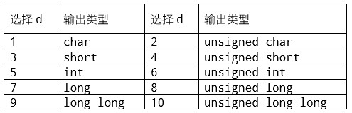

# 003 数据类型大小及范围

Time Limit: 1000ms , Memory Limit: 10000KB

## Description

每一个C/C++整型，都有一个内存大小和数值范围。例如：int，内存大小为4，数值范围为（-2147483648,2147483647）。如下表，输入选择d，输出对应数据类型的大小及范围。



## Input

输入整数d。

## Output

输出对应数据类型的内存大小及数值范围（最小值、最大值），用逗号间隔。

## Sample Input

```
5
```

## Sample Output

```
4,-2147483648,2147483647
```

---
---

## 测试点
