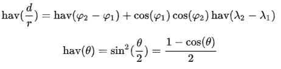

# 008 计算地球上两点之间的距离

> 提交文件名：`T008.cpp` ｜ 时限 1000ms ｜ 内存 10000KB

## 题目描述

依据Haversine公式。对于任何球面上的两点，圆心角的半正矢值可以通过hav(d/r)公式计算，其中hav(θ)是半正矢函数，d是两点之间的距离，r是地球半径（6371km），φ1和φ2是点1的纬度和点2的纬度，以弧度为单位，λ1和λ2是点1的经度和点2的经度，以弧度为单位。如下：



## 输入

输入2行数据，每行数据是点的纬度和经度，用空格间隔。例如西安（34.260958，108.942369），莫斯科（55.755825，37.617298）。

## 输出

输出两点的距离，单位是km，小数点保留4位。

## 样例

**输入**

```
34.260958 108.942369
55.755825 37.617298
```

**输出**

```
5793.2236km
```

## 来源

jxf
