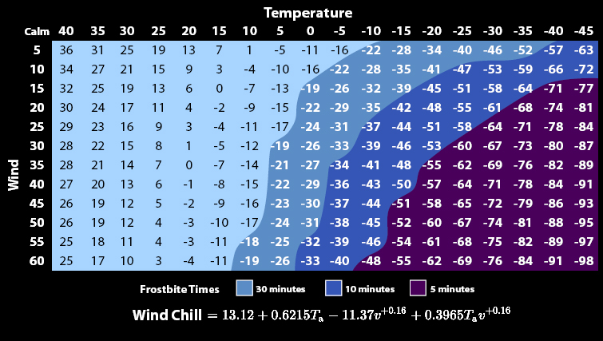

# 009 风寒指数

> 提交文件名：`T009.cpp` ｜ 时限 1000ms ｜ 内存 10000KB

## 题目描述

已知风速和空气温度，计算寒意指数。公式如下图。



## 输入

在一行中输入风速（公里/小时）、空气温度（摄氏温度），用空格间隔。

## 输出

输出寒意指数（四舍五入整数）。

## 样例

**输入**

```
120 35
```

**输出**

```
40
```

## 来源

jxf
