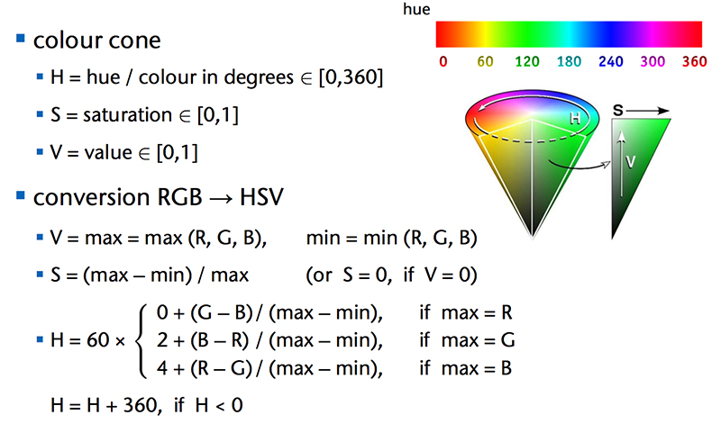

# 010 颜色模型转换

> 提交文件名：`T010.cpp` ｜ 时限 1000ms ｜ 内存 10000KB

## 题目描述

RGB是一种颜色空间，R是红色分量，G是绿色分量，B是蓝色分量。RGB是图像处理中最基本、最常用、面向硬件的颜色空间，适合于显示系统，却并不适合于图像处理。HSV是另一种颜色空间，H是色调，S是饱和度，V是明度，它比RGB更接近人们对彩色的感知经验，方便进行颜色的对比。RGB转换成HSV的算法如下图，其中R, G, B ∈ [0, 1]。



## 输入

在一行中输入R、G、B的字节值，范围为[0，255]，用空格间隔。

## 输出

输出为H，S%，V%，用逗号间隔，保留4位小数。

## 样例

**输入**

```
0 215 0
```

**输出**

```
120.0000,100.0000%,84.3137%
```

## 来源

jxf
