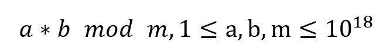

# 011 乘数模

Time Limit: 1000ms , Memory Limit: 10000KB

## Description

已知三个正整数a、b、m，求



mod表示求余运算。

## Input

在一行里输入三个正整数a、b、m，用空格间隔。

## Output

输出计算结果。

## Sample Input

```
123 456 100000
```

## Sample Output

```
56088
```
