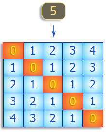

# 012 方阵

Time Limit: 1000ms , Memory Limit: 10000KB

## Description

编写程序，生成一个n阶正方形矩阵，其中0位于主对角线，1位于主对角线上方和下方的位置中，2位于更上方和下方，等等，依次类推。如下图所示。



## Input

输入正整数n。

## Output

输出指定要求的方阵。

## Sample Input

```
5
```

## Sample Output

```
0 1 2 3 4
1 0 1 2 3
2 1 0 1 2
3 2 1 0 1
4 3 2 1 0
```

---
---

## 测试点
