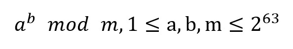

# 013 幂数模

> 提交文件名：`T013.cpp` ｜ 时限 1000ms ｜ 内存 10000KB

## 题目描述

已知三个正整数a、b、m，求



mod表示求余运算。

## 输入

在一行里输入三个正整数a、b、m，用空格间隔。

## 输出

输出计算结果。

## 样例

**输入**

```
2 10 9
```

**输出**

```
7
```

## 来源

https://www.luogu.com.cn/problem/P1226
