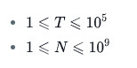

# 015 倍数和

Time Limit: 1000ms , Memory Limit: 10000KB

## Description

小于10的自然数中，3或5的倍数有3、5、6和9，这些数之和是23。求小于n的自然数中所有3或5的倍数之和。

## Input

第一行输入整数T，表示接下来有T行数据需要处理。接下来的T行，每行输入一个正整数n（称为一个测试用例）。T和n的范围如下：



## Output

对于每一个测试用例，输出倍数之和，一行一个。

## Sample Input

```
2
10
100
```

## Sample Output

```
23
2318
```

---
---

## 测试点
