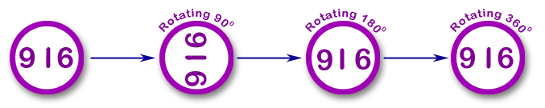

# 016 对称数

Time Limit: 1000ms , Memory Limit: 10000KB

## Description

一个对称数是指该数字经过360度旋转以后，依然是该数字，如下图所示。编写程序判断一个数是否是对称数。



## Input

输入一个整数n。

## Output

如果是对称数输出Yes，否则输出No。

## Sample Input

```
916
```

## Sample Output

```
Yes
```

---
---

## 测试点

### 测试点 1

输入：

```
916
```

输出：

```
Yes
```

### 测试点 2

输入：

```
123456789
```

输出：

```
No
```

### 测试点 3

输入：

```
91688916
```

输出：

```
Yes
```

