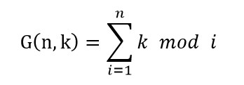

# 021 余数和

Time Limit: 1000ms , Memory Limit: 10000KB

## Description

给定正整数n和k，计算



其中k mod i表示k除以i的余数。

## Input

在一行里输入2个整数n、k，用空格间隔。

## Output

输出G函数的结果。

## Sample Input

```
10 5
```

## Sample Output

```
29
```

---
---

## 测试点
