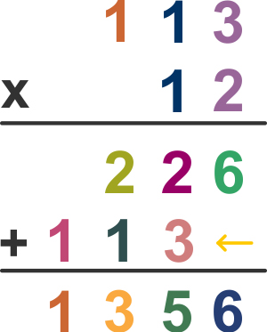

# 023 竖式乘法

Time Limit: 1000ms , Memory Limit: 10000KB

## Description

输入两个整数，输出它们的竖式乘法的结果。



## Input

在一行里输入2个整数a、b，用空格间隔，输入数据保证有意义。

## Output

输出a*b的竖式乘法，参见输出样例。注意乘号x、加号+的位置，算式隔行用减号“-”制作。

## Sample Input

```
12345 120
```

## Sample Output

```
12345
x    120
--------
       0
  24690
+12345
--------
 1481400
```

---
---

## 测试点

### 测试点 1

输入：

```
12345 120
```

输出：

```
   12345
x    120
--------
       0
  24690
+12345
--------
 1481400
```

### 测试点 2

输入：

```
12345 105
```

输出：

```
   12345
x    105
--------
   61725
      0
+12345
--------
 1296225
```

