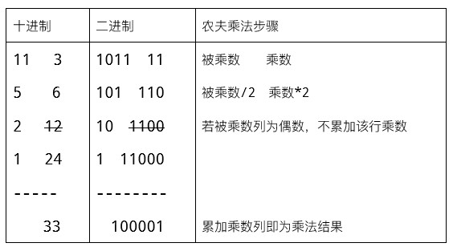

# 024 俄罗斯农夫乘法

> 提交文件名：`T024.cpp` ｜ 时限 1000ms ｜ 内存 10000KB

## 题目描述

19世纪，当西方游客来到俄罗斯时，发现那里的农夫广泛使用一种乘法方法，称为俄罗斯农夫乘法。后来，人们发现这种方法，古埃及数学家早在公元前1800年就使用了。俄罗斯农夫乘法相当于微处理器使用二进制算法进行乘法运算的方式，因此预示了现代计算机的乘法运算方式。
俄罗斯农夫乘法具体是：在纸上，左边写下被乘数，右边写下乘数；被乘数的下方写下被乘数反复除二（且无条件舍去小数）的结果，乘数下方写上乘数反复乘二的结果，一直到被乘数那一栏为1为止。将乘数那一列的数字相加，若被乘数那一列为偶数，则跳过此数不累加。所得结果即为乘法的结果。如下图所示。



## 输入

在一行里输入2个整数a、b，用空格间隔。输入数据保证有意义。

## 输出

输出农夫乘法的过程，被乘数和乘数列用空格间隔，最后一行输出累加结果。参见输出样例。

## 样例

**输入**

```
11 3
```

**输出**

```
11 3
5 6
2 12
1 24
33
```

## 来源

https://en.wikipedia.org/wiki/Multiplication_algorithm
