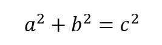

# 027 毕达哥拉斯三元组

> 提交文件名：`T027.cpp` ｜ 时限 1000ms ｜ 内存 10000KB

## 题目描述

毕达哥拉斯三元组由三个自然数a<b<c组成，满足



有一个特殊三元组还满足a+b+c=n，求它的abc乘积。

## 输入

输入n。

## 输出

输出三元组的乘积。

## 样例

**输入**

```
1000
```

**输出**

```
31875000
```

## 来源

https://pe-cn.github.io/9/
