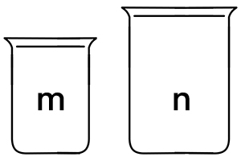

# 028 倒水

Time Limit: 1000ms , Memory Limit: 10000KB

## Description

有两个杯子，容积分别是m升和n升，其中0<m<n。两个杯子最初都是空的，且杯子上没有任何标记，无法进行测量。现在利用两个杯子操作得到d 升水，d<n，水源不限。求得到d升水所需要的最少操作次数。



可以执行的操作有：
（1）倒空一个杯子；
（2）装满一个杯子；
（3）将水从一个杯子倒入另一个杯子，直到其中一个杯子为空或满。
例如m=3、n=5、d=4时，可以有（括号为m升和n升的杯子状况）
倒法一：
(0,0)→(3,0)→(0,3)→(3,3)→(1,5)→(1,0)→(0,1)→(3,1)→(0,4)，需要执行操作次数是8。
倒法二：
(0,0)→(0,5)→(3,2)→(0,2)→(2,0)→(2,5)→(3,4)，需要执行操作次数是6。
因此，最少操作次数为6。

## Input

在一行里输入3个整数m、n、d，用空格间隔。输入数据保证有意义。

## Output

输出最少操作次数。

## Sample Input

```
3 5 4
```

## Sample Output

```
6
```

---
---

## 测试点
