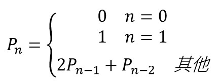
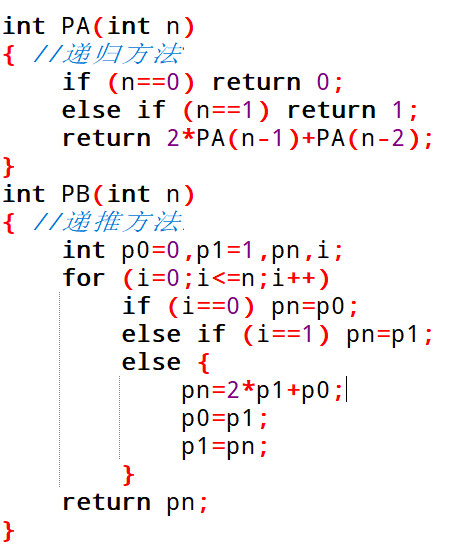

# 032 佩尔数

> 提交文件名：`T032.cpp` ｜ 时限 1000ms ｜ 内存 10000KB

## 题目描述

佩尔数由以下关系定义：



下面分别给出使用递归方法和递推方法的佩尔函数PA或PB，求解佩尔数。



前20个佩尔数分别是0、1、2、5、12、29、70、169、408、985、2378、5741、13860、33461、80782、195025、470832、1136689、2744210、6625109，显然佩尔数比斐波拉契数列更快地增长。

## 输入

输入n。

## 输出

当n为奇数调用递归方法PA函数，当n为偶数调用递归方法PB函数，输出佩尔数。

## 样例

**输入**

```
10
```

**输出**

```
2378
```

## 来源

https://www.w3resource.com/c-programming-exercises/numbers/index.php，35
https://en.wikipedia.org/wiki/Pell_number
