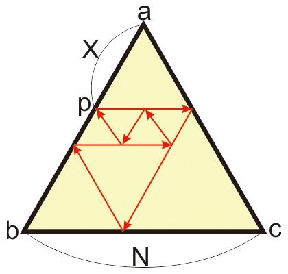

# 033 光线追踪

Time Limit: 1000ms , Memory Limit: 10000KB

## Description

用三面长度为N的镜子组成一个等边三角形△abc，如下图所示。



在ab边上任取一点p，ap长度为X。从该点水平方向向右射入一束红光，接下来它遇到镜子或者自己的轨迹，都会反射。可以证明，光最后是从p点射出的。编程求光线轨迹的总长度。

## Input

在一行里输入整数N、X，用空格间隔。其中，$`2 \leqslant N \leqslant 10^{12}`$，$`1 \leqslant X \leqslant N-1`$。

## Output

输出光线轨迹的总长度。
样例解释：当N=5，X=2时，如图中红线，光线轨迹的总长度=2+3+2+2+1+1+1=12。

## Sample Input

```
5 2
```

## Sample Output

```
12
```

---
---

## 测试点

### 测试点 1

输入：

```
5 2
```

输出：

```
12
```

### 测试点 2

输入：

```
1000000000 100
```

输出：

```
2999999700
```
