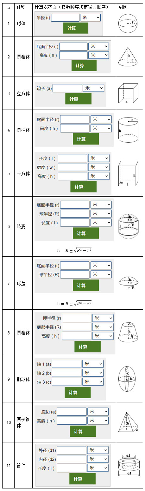

# 035 体积计算器【C++】

Time Limit: 1000ms , Memory Limit: 10000KB

## Description

NPU大作业要开发一个体积计算器，求几种常见形状的体积，如下图所示设计了它们的用户界面UI，输入相应的参数，单击“计算”按钮进行计算。
现在你负责开发体积计算器的算法部分（在专业软件开发中称为逻辑或业务部分），采用C++函数重载技术，函数名称必须是VolCalc。这样，就可以用一个名称计算多种形状体积，其函数原型如下：
double VolCalc(double r); //球体
double VolCalc(double r,double h); //圆锥体
double VolCalc(long a); //立方体
double VolCalc(double r,long h); //圆柱体
double VolCalc(long l,long w,long h); //长方体
double VolCalc(double r,double R,double h); //球盖
double VolCalc(double r,double R,double h,double l); //胶囊
double VolCalc(long r,double R,double h); //圆锥体
double VolCalc(double a,double b,long c); //椭球体
double VolCalc(long a,long h); //四棱锥
double VolCalc(long d1,long d2,double l); //管件



## Input

在第一行里输入整数T，表示有T个测试用例。
在接下来的T行里，每行先是n，表示是什么形状，参考上图，接着是若干个参数，不同的n有不同数目的参数，而且参数的顺序由图中所列决定。中间用空格间隔。

## Output

针对每行测试样例，输出相应形状的体积，每行一个。
需要注意：球盖和胶囊由于h计算的问题，体积是两个结果（h先计算加，再计算减），中间用空格间隔。

## Sample Input

```
11
1 3
2 3 5
3 6
4 5 12
5 1 2 3
6 5 7 12
7 5 7
8 3 4 5
9 6 7 8
10 5 10
11 12 8 6
```

## Sample Output

```
113.097334
47.123889
216.000000
942.477780
6.000000
3641.261807 1117.203784
1349.392014 87.363002
193.731544
1407.433485
83.000000
376.991112
```
