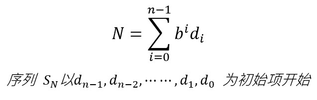

# 038 基思数

Time Limit: 1000ms , Memory Limit: 10000KB

## Description

数学中，基思数（Keith number）又称Repfigit（REPetitive FIbonacci-like diGIT）数，它是一个用特定起始项的线性递推关系数列来定义的整数。假定有一个b进位制的n位数



每一项都由前面n项和产生，如果N出现在序列S中，那么N就是基思数。
是否存在无穷多个基思数仍然是个有待论证的问题，但$`10^{19}`$以下的基思数只有71个，比素数还稀有。
例如197，以十进制按照上面的方法建立一个序列：
1
9
7
1+9+7=17
9+7+17=33
7+17+33=57
17+33+57=107
33+57+107=197
……
因此197为基思数。
编写一个内联函数inline IsKeith(int N);，判断N是否为基思数，若是返回1，否则返回0。

## Input

输入N（$`10 \leqslant N \leqslant 99999999`$）。

## Output

调用IsKeith函数，如果是基思数输出Yes，否则输出No。

## Sample Input

```
197
```

## Sample Output

```
Yes
```

---
---

## 测试点

### 测试点 1

输入：

```
197
```

输出：

```
Yes
```

### 测试点 2

输入：

```
1084052
```

输出：

```
No
```

### 测试点 3

输入：

```
44121607
```

输出：

```
Yes
```

### 测试点 4

输入：

```
10
```

输出：

```
No
```

