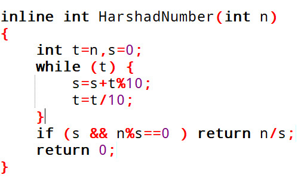

# 039 哈沙德数

Time Limit: 1000ms , Memory Limit: 10000KB

## Description

哈沙德数（Harshad number）又称尼云数，它是可以在某个固定的进位制中，被各位数字之和整除的整数。若一个数无论在任何进位制中都是哈沙德数，称为全哈沙德数，只有四个全哈沙德数：1, 2, 4, 6，12在除八进制以外的进制中均为哈沙德数。所有在零和进位制的底数之间的数都是哈沙德数，除非是个位数，否则质数不是哈沙德数。在十进制中，100以内的哈沙德数有：1, 2, 3, 4, 5, 6, 7, 8, 9, 10, 12, 18, 20……。6804称为4重哈沙德数，因为6804/(6+8+0+4)=378/(3+7+8)=21/(2+1)=7/7=1，可连续4次整除都是哈沙德数。



上述代码用来求哈沙德数，函数返回0表示n不是哈沙德数，返回其他表示n是哈沙德数且返回值为整除结果。

## Input

输入n。

## Output

调用上述函数，输出n是几重哈沙德数，为0表示它不是哈沙德数，为1表示它是一重哈沙德数，依此类推。

## Sample Input

```
6804
```

## Sample Output

```
4
```
