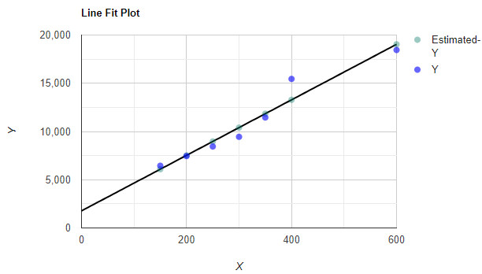

# 041 【专业融合：计算机】波士顿房价预测

Time Limit: 1000ms , Memory Limit: 10000KB

## Description

学习人工智能和数据科学，往往从机器学习开始，其中线性回归是基础之一。
回归模型是一种预测性的建模技术，它研究的是因变量（目标）和自变量（预测器）之间的关系，这种技术通常用于预测分析，时间序列模型以及发现变量之间的因果关系，目前回归模型有很多，包括线性、多项式、支持向量机、决策树、随机森林、LASSO、Ridge、ElasticNet、XGBoost等。线性回归是一种线性模型，它假设输入变量 (x) 和单个输出变量 (y) 之间存在线性关系。一般来说，有两种情况：

- （1）单变量线性回归：它对单个输入变量（单个特征变量）和单个输出变量之间的关系进行建模。
- （2）多变量线性回归（也称为多元线性回归）：它对多个输入变量（多个特征变量）和单个输出变量之间的关系进行建模。
房子作为居住的场所，对每个人而言是不可或缺的。而房价的高低也是受多种因素的影响。房子所处的城市是一线还是二线，房子周边的交通便利程度，房子附近是否存在医院或者学校等，众多因素都会影响房价。
波士顿房价数据集（Boston House Price，http://lib.stat.cmu.edu/datasets/boston）包含美国人口普查局收集的有关马萨诸塞州波士顿地区住房的信息。
本题以简化的波士顿房价数据集（房屋面积与房价关系），进行模型训练，预测波士顿房价。一般来说，房子越大，房屋的价值越高。于是可以推断出，房子的价值是与房屋面积有关的。这个案例中房子面积是自变量，房屋价格是因变量,因此，要预测房屋价格，就需要从给出的数据集中，找出符合 $`Y=a+bX`$ 模型的线性方程。
其基本思路是依据给定的数据集（X,Y），如果我们的数据显示线性X和Y之间存在关系，那么最能描述这种关系的直线就是回归线，它是覆盖图中最大点的直线，即为了找到回归线，需要求出a和b。

## Input

在第一行里输入n，表示n组数据集，接下来n行每行有2个整数X、Y，用空格间隔，表示数据集（X-房屋面积，Y-价格）。

## Output

输出结果形如y=a+bx，小数点保留4位。样例数据图示如下。



## Sample Input

```
7
150 6450
200 7450
250 8445
300 9450
350 11450
400 15450
600 18450
```

## Sample Output

```
Y=1770.2394+28.7793*X
```

---
---

## 测试点
