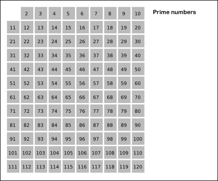
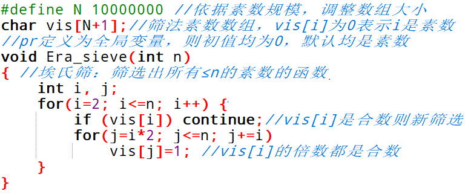

# 043 素数筛选法

Time Limit: 1000ms , Memory Limit: 10000KB

## Description

公元前1550年左右的《莱茵德数学纸莎草纸》中有不同形式的素数和合数的埃及分数展开式。然而，现存最早的对素数的明确研究的记录来自古希腊数学。欧几里得的《几何原本》（约公元前300年）证明了素数的无穷性和算术基本定理，并展示了如何从梅森素数构造完美数。另一项希腊发明，埃拉托斯特尼筛法（简称埃氏筛），至今仍被用来构建素数列表。如下图所示动画，展示了埃氏筛的方法。



埃氏筛应用了素数的倍数是合数的原理，筛选出所有≤n的素数方法是：
（1）创建从2到n的连续整数列表（2, 3, 4, ..., n）。
（2）最初，让p等于2，即最小的素数。
（3）通过以p从2 p到n为增量进行计数来枚举p的倍数，并将它们标记在列表中（2p、3p、4p……）。
（4）找出列表中大于p且未标记的最小数。如果没有这个数字，就停止。否则，让p现在等于这个新数字（即下一个素数），并从步骤3 开始重复。
（5）当算法终止时，列表中剩余未标记的数字都是n以下的素数。
下面是埃氏筛的实现代码



可以计算出埃氏筛的时间复杂度为O(nloglogn)。下面我们介绍更快的欧拉筛。
观察埃氏筛，例如12、18被重复遍历了多次，对于一个合数来说，我们只需要让它被最小的素数筛掉即可。为此，我们建立一个pr数组，对上面的第二个j循环，从小到大枚举pr数组，当枚举到一个素数pr[j]能够整除i时，pr[j]一定是i的最小质因子，pr[j]也一定是i×pr[j]的最小质因子，接下来的i×pr[j+1]的最小质因子必然是pr[j]而不是pr[j+1]，因此这个时候直接break即可。
由于欧拉筛保证每个合数只被自己的最小质因子筛掉一次，所以时间复杂度是O(n)。

## Input

输入一个整数n（1≤n≤10000000）。

## Output

输出小于等于n的所有素数的个数。

## Sample Input

```
100
```

## Sample Output

```
25
```

---
---

## 测试点

待探测。
