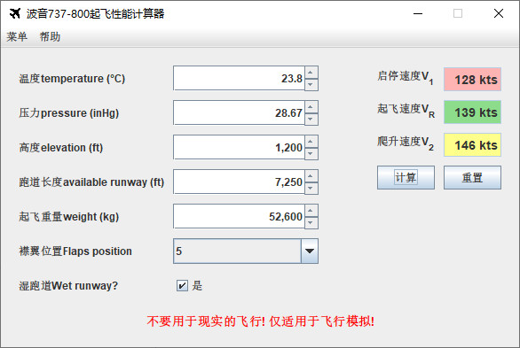
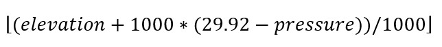
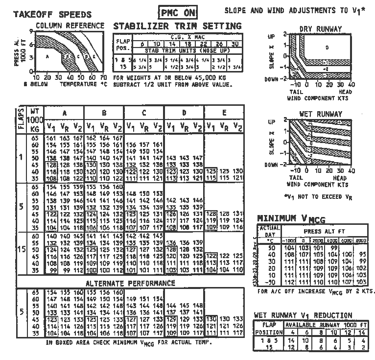

# 046 【专业融合：航空】飞机起飞速度

Time Limit: 1000ms , Memory Limit: 10000KB

## Description

空院同学被要求完成一个大作业，设计飞机起飞速度计算器。UI君负责设计界面如下，算法君——你负责设计算法。



参考波音737起飞速度表（http://www.b737.org.uk/pilotnotes.htm），如下图，起飞速度计算步骤为：
（1）温度每10度一档，有0-10-20-30-40-50-60-70共七档（向下取整）
（2）气压转换公式如下，有0-1-2-3-4-5-6-7-8-9共十档（向上取整）



（3）由温度档和气压档，查操纵参考表（COLUMN Reference），得到操纵参考值A~E。
（4）以襟翼位置、起飞重量、操纵参考值查表得到V1、Vr、V2
（5）如果是湿跑道，以跑道长度、襟翼位置查折扣表（V1 Reduction）,不在表内的折扣值为0；最终V1需要减去折扣值。



## Input

输入数据保证有意义。
输入第一行为temperature、pressure，用空格间隔，均为double。
输入第二行为elevation、runway、weight、Flaps、Wet，用空格间隔，均为int。如果是湿跑道Wet=1，否则Wer=0。

## Output

Flaps必须为1、5、15之一，起飞重量41413≤weight≤65000，起飞跑道runway必须大于6900，查表时操纵参考值不是A~E，或者表格中无V1、Vr、V2，均不能起飞，此时输出“Flight not possible!”（注意大小写）。
能够起飞时，分别输出V1、Vr、V2，单位为“kts”，格式参考样例。

## Sample Input

```
23.8 28.67 1200 7250 52600 5 1
```

## Sample Output

```
V1=128kts Vr=139kts V2=146kts
```

---
---

## 测试点

待探测。
