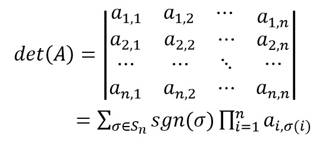

# 047 【专业融合：数学】行列式值

Time Limit: 1000ms , Memory Limit: 10000KB

## Description

计算一个矩阵的行列式的值。



可以在互联网上查找行列式具体的计算方法。

## Input

在第一行里输入n，接下来的n行，每行输入n个数据（用空格间隔），得到n×n的矩阵。

## Output

输出矩阵的行列式的值。

## Sample Input

```
3
2 6 3
1 0 2
5 8 4
```

## Sample Output

```
28
```
