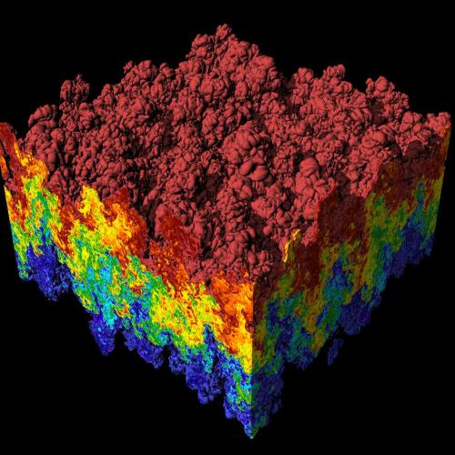
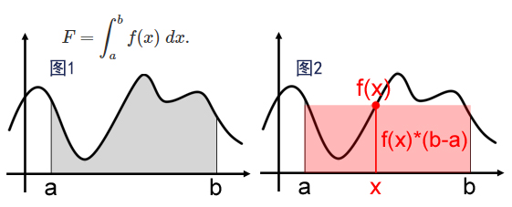
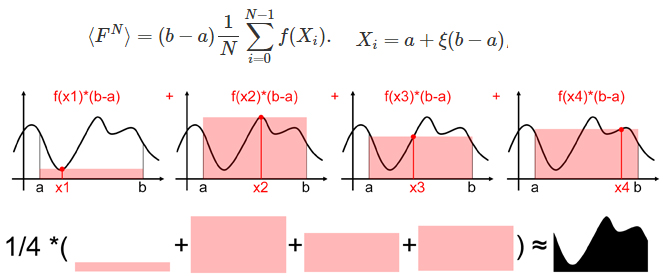
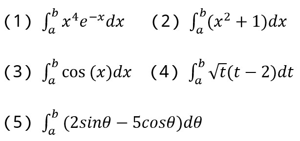

# 049 【专业融合：物理】蒙特卡罗方法求积分

Time Limit: 1000ms , Memory Limit: 10000KB

## Description

计算物理学是研究和实施数值分析来解决物理学问题的学科。例如瑞利-泰勒不稳定性，是两种不同密度流体之间界面的不稳定性，当较轻的流体推动较重的流体时会发生这种情况，下图是瑞利-泰勒不稳定性超大规模模拟的可视化，该图像由C++编写、开源的VisIt可视化系统（https://visit-dav.github.io/visit-website/）生成。



计算物理学通常分为其数值解决的不同数学问题或其应用的方法，例如蒙特卡罗积分，它是一种使用随机数进行数值积分的技术，对于高维积分特别有用。20世纪40年代，洛斯阿拉莫斯实验室开发该方法是为了帮助模拟核裂变过程，特别是模拟裂变材料中中子的平均自由程。
对于一维函数f(x)在[a,b]区间上的积分，可以解释为计算函数曲线下方的面积，如图1所示。用蒙特卡洛算法来估计积分，其原理为选取一个随机值x，计算函数f(x)，并乘上ba，可以将矩形面积视为积分的粗略近似。



当我们不断在 a 和 b 之间的不同随机点评估函数，将矩形面积相加并对总和求平均时，得到的数字越来越接近积分的实际结果。如下图所示。用公式形式化这个思路，其中N是该近似中使用的样本数。FN是使用N个样本的F的近似值，该方程称为基本蒙特卡罗估计量。区间[a,b]中的随机点Xi可以通过将生成区间 [0,1] 中均匀分布的随机生成器的结果与ba相乘来获得。



应用上述方法求如下积分



## Input

在一行里输入4个数m、a、b、N，用空格间隔，m、N为int，a、b为double，表示求(m)在区间[a,b]的积分、样本量为N。输入数据保证有意义。
注意，调用srand(RAND_MAX)初始化随机器，rand()获得随机数。
本题可使用NOC在线编译器 http://10.12.13.248/oc/ 查阅结果区别。

## Output

输出积分计算结果，小数点保留六位。

## Sample Input

```
1 1 5 2000
```

## Sample Output

```
13.317870（NOC为13.613636）
```

---
---

## 测试点

待探测。
