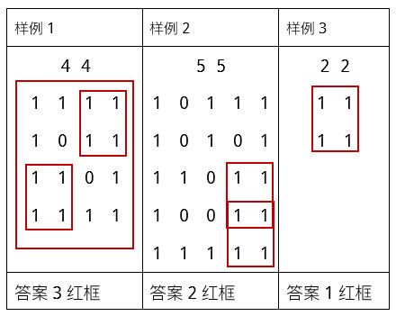

# 050 完美矩阵

Time Limit: 1000ms , Memory Limit: 10000KB

## Description

一个由0和1形成的矩阵，如果满足下面三个条件，称为完美矩阵：
（1）矩阵至少是2x2的；
（2）矩阵的四边必须都是1；
（3）除开四边外，矩阵内部0的个数和1的个数的差值不能超过1。
给定一个nxm的01矩阵，计算它包含的完美矩阵（或子矩阵）的个数。B矩阵是A矩阵的子矩阵的条件是，当且仅当B是由A从上和从下删除几行（或0行）、从左和从右删除几列（或0列）形成的。注意，矩阵不一定是方阵。

## Input

第一行包含2个整数n,m（1≤n,m≤300）。接下来的n行每行有m个整数，用空格间隔，每个整数要么是0，要么是1。

## Output

输出完美矩阵（或子矩阵）的数目。样例解释如下：



## Sample Input

```
4 4
1 1 1 1
1 0 1 1
1 1 0 1
1 1 1 1
```

## Sample Output

```
3
```
