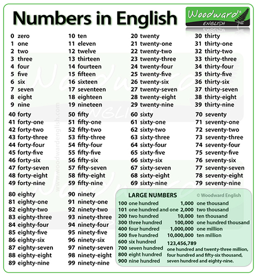

# 055 Kids A+B

Time Limit: 1000ms , Memory Limit: 10000KB

## Description

Kids刚刚结束小学一年级的学习生活，他的数学老师布置了无数个两位数之内的加法作业。热情的NPUer，你能够帮助Kids偷个懒吗？对了，Kids是英国人，下面是他学到的数字。



## Input

在一行里输入2个英文表示的整数a、b（均是小写），用空格间隔。输入数据保证有意义。所有数据包括结果都是两位数以内（即0~99）。

## Output

输出英文表示的结果。

## Sample Input

```
twenty-seven fifty-four
```

## Sample Output

```
eighty-one
```

---
---

## 测试点

### 测试点 1

输入：

```
twenty-seven fifty-four
```

输出：

```
eighty-one
```

### 测试点 2

输入：

```
zero zero
```

输出：

```
zero
```

### 测试点 3

输入：

```
five thirty
```

输出：

```
thirty-five
```
