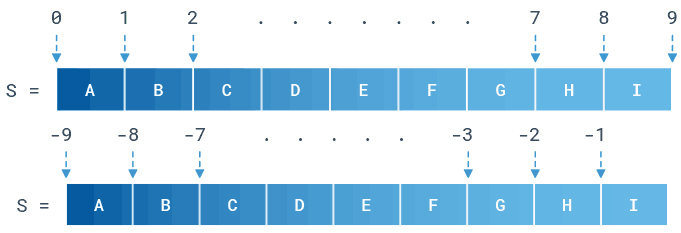

# 060 字符串切片

Time Limit: 1000ms , Memory Limit: 10000KB

## Description

Python允许对字符串做“切片”操作，通过s [ start : stop : step ] 这样的运算实现。它表示从start开始（包含start），每次步长step（增量），直到stop停止（不包含stop），逐个提取字符串s的字符。s的下标可以是正的，从零开始；也可以是负的，从-1开始。-1下标的字符是该字符串最后一个字符，然后往前数，如下图所示。



如果S字符串为“ABCDEFGHI”，则有下面的运算及结果。

1. （1）S[2:7]得到“CDEFG”，如果不提供step，则step默认为1。
2. （2）S[-7:-2]得到“CDEFG”，start和stop可以同时为负值。参考上图。
3. （3）S[2:-5]得到“CD”，start和stop可以一个为负值。参考上图。
4. （4）S[2:7:2]得到“CEG”，step为2，正序间隔提取字符。
5. （5）S[6:1:-2]得到“GEC”，step为-2，倒序间隔提取字符。
6. （6）S[:3]得到“ABC”，start不提供默认从0开始，step默认为1。
7. （7）S[6:]得到“GHI”，stop不提供默认为字符串末尾结束，step默认为1。
8. （8）S[::-1]得到“IHGFEDCBA”，特例，不提供start和stop，step为-1，反序提取全部字符。

编写一个切片函数，string str_slice(string src,int start, int stop, int step); 将源字符串src的字符按上述规律提取到新字符串中，并函数返回。

## Input

在第一行里输入一个源字符串src，第二行输入一个整数T，表示测试用例数目。接下来的T行，每行输入参数个数n、起始start、结束stop、步长step。当n为3，后面输入start、stop、step，n为2，后面输入start、stop（此时step默认为1），n为1，后面输入start（此时stop默认为字符串长度、step默认为1）。输入数据保证有意义。

## Output

针对每个测试用例，输出字符串切片的结果。

## Sample Input

```
ABCDEFGHI
8
2 2 7
2 -7 -2
2 2 -5
3 2 7 2
3 6 1 -2
2 0 3
1 6
3 -1 -10 -1
```

## Sample Output

```
CDEFG
CDEFG
CD
CEG
GEC
ABC
GHI
IHGFEDCBA
```

---
---

## 测试点
