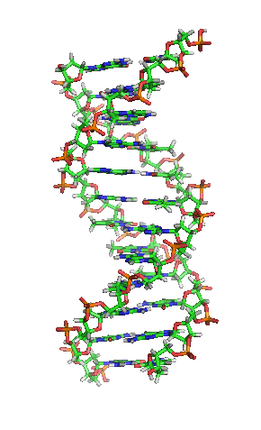

# 061 【专业融合：生物】DNA双螺旋结构

Time Limit: 1000ms , Memory Limit: 10000KB

## Description

脱氧核糖核酸（Deoxyribonucleic acid，缩写DNA）是一种生物大分子，可组成遗传指令，引导生物发育与生命机能运作。DNA主要功能是信息储存，可比喻为“蓝图”或“配方”。1953年，沃森和克里克发现了DNA双螺旋结构，开启了分子生物学时代，使遗传的研究深入到分子层次。
DNA主要由4种碳氢化合物组成，即胞嘧啶[C]、鸟嘌呤[G]、腺嘌呤[A]、胸腺嘧啶[T]。DNA碱基相互配对，A与T，C与G，形成称为碱基对的单元。如下图，两条绿色和红色的糖-磷酸骨架相互缠绕，由图中水平方向蓝色和绿色的配对碱基之间的氢键结合。



现在测定DNA组合（形式为上叶-下叶）顺序为：
（1）ATTAATTA-TAGCTAGC
（2）CGCGATAT-TAATATGC
（3）ATCGTACG-CGTAGCAT
给定一个n，即上下叶的数量，输出脱氧核糖核酸的双螺旋结构。

## Input

在一行里输入n。输入数据保证有意义。

## Output

输出双螺旋结构DNA（纵向）图案。

## Sample Input

```
8
```

## Sample Output

```
AT
  T--A
 A----T
T------A
T------A
 G----C
  T--A
   GC
   CG
  C--G
 A----T
A------T
T------A
 A----T
  A--T
   GC
   AT
  C--G
 T----A
C------G
C------G
 T----A
  G--C
   AT
   AT
  T--A
 A----T
T------A
T------A
 G----C
  T--A
   GC
```

---
---

## 测试点

待探测。
