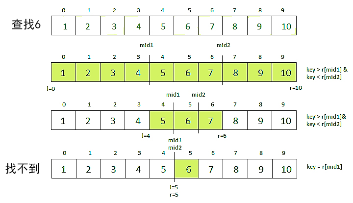

# 062 三元搜索

Time Limit: 1000ms , Memory Limit: 10000KB

## Description

查阅互联网，三元搜索算法（[Ternary search](https://en.wikipedia.org/wiki/Ternary_search)）是用于查找单峰函数的最小值或最大值的技术。其算法步骤是：
一、初始化：

1. （1）从排序数组开始。
2. （2）设置两个下标left和right，最初指向数组的第一个和最后一个元素。

二、划分数组：

1. （1）计算两个中点mid1和mid2，将当前搜索空间分为三个大致相等的部分：
2. （2）mid1 = left + (right – left) / 3
3. （3）mid2 = right – (right – left) / 3
4. （4）该数组现在有效地分为[left, mid1]、(mid1, mid2 )和[mid2, right]。

三、与目标比较：

1. （1）如果key等于mid1或mid2处的元素，则查找成功，并返回索引
2. （2）如果key小于mid1处的元素，则将右下标更新为mid1 – 1。
3. （3）如果key大于mid2处的元素，则将左下标更新为mid2 + 1。
4. （4）如果key位于mid1和mid2的元素之间，则将左下标更新为mid1 + 1，将右下标更新为mid2 – 1。

四、重复或结论：

1. （1）使用缩小的搜索空间重复该过程，直到找到key或搜索空间变空。
2. （2）如果搜索空间为空并且未找到key，则返回-1，表示key不在数组中。

如下示意



## Input

在第一行里输入n，在第二行输入n个整数，用空格间隔，在第三行输入要查找的key。n个整数已排好序。

## Output

如果找到key，输出“%d in [%d]”格式的结果，表示“key in [所在下标]”。如果找不到，所在下标为-1。

## Sample Input

```
10
1 2 3 4 5 6 7 8 9 10
5
```

## Sample Output

```
5 in [4]
```

---
---

## 测试点
