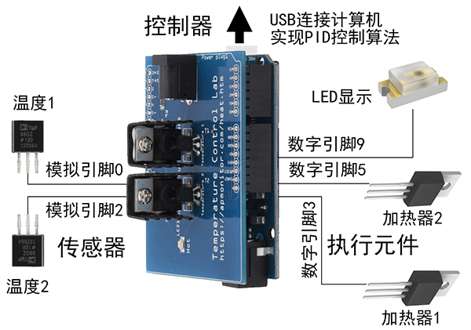
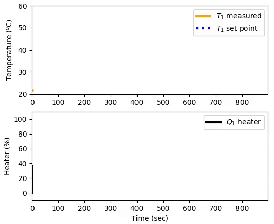
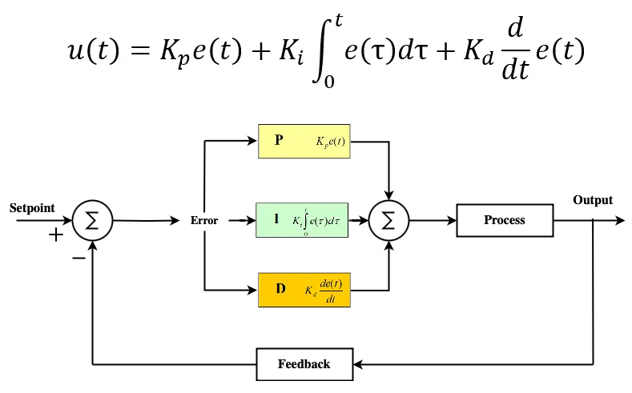
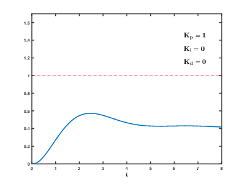

# 064 【专业融合：自动化】PID控制

Time Limit: 1000ms , Memory Limit: 10000KB

## Description

PID控制是自动控制系统中最常见的控制算法之一。PID控制器可以通过反馈信号调整输出来控制系统的行为，在实际应用中，PID可以控制温度、湿度、速度、位置等。
通过使用Arduino、LED、两个加热器和两个温度传感器，我们可以搭建一个温度控制实验，来自加热器的热能通过传导、对流和辐射传递到温度传感器measuredValue，调节加热器功率输出以控制所需的温度setpoint。如下图所示：



下面是PID温度控制实验过程曲线图。



下面是PID控制器公式及闭环系统框图



下面是PID曲线响应，可以看出P（比例）、I（积分）、D（微分）环节的控制作用。



下面是控制步骤
一、定义一个PID数据类型
typedef struct PIDController {
    double Kp, Ki, Kd; //比例、积分、微分系数
    double preError, integral; //前次误差、积分
} PIDData; //PID数据类型
二、初始化Kp, Ki, Kd，preError和 integral初始为0。
三、编写一个函数double PIDCalculate(PIDData *pid, double setpoint, double measuredValue);为下面的步骤
（1）setpoint为控制值，measuredValue为传感器测量值
（2）计算setpoint –measuredValue为本次误差error
（3）PID积分integral累加error
（4）计算本次误差与前次误差的微分
（5）按PID公式计算控制输出output=Kp * error + Ki * integral + Kd * 微分，output施加到执行元件
（6）前次误差=本次误差，测量值累加output

## Input

在第一行里输入PID三个整数Kp、Ki、Kd，用空格间隔。
在第二行里输入控制值setpoint、测量值measuredValue，用空格间隔。
在第三行里输入n时长。输入数据保证有意义。

## Output

输出1到n时间点的控制输出，每行格式为时间点序号、控制输出（保留小数点六位）。

## Sample Input

```
0.1 0.01 0.05
100 0
100
```

## Sample Output

```
1 16.000000
2 25.440000
3 35.009600
...
48 99.933190
49 99.104069
50 98.362420
...
98 100.769291
99 100.754719
100 100.734384
```
