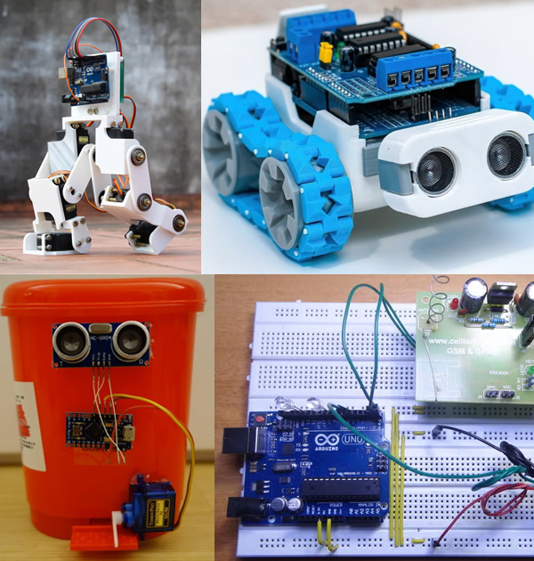
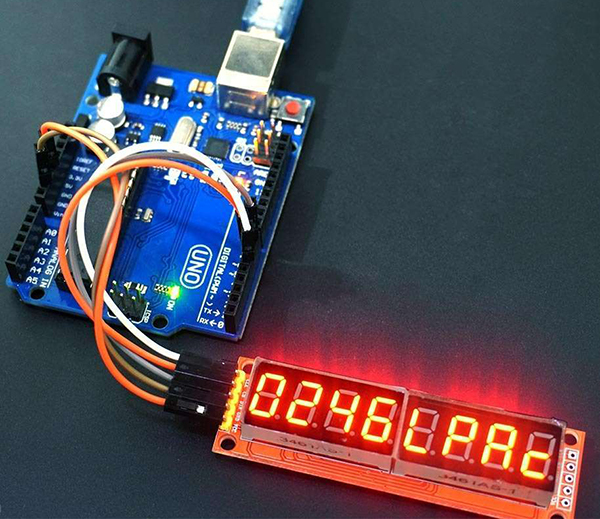

# 067 【专业融合：电子】Arduino显示

> 提交文件名：`T067.cpp` ｜ 时限 1000ms ｜ 内存 10000KB

## 题目描述

Arduino是一个开源嵌入式硬件平台，用来制作可交互式的嵌入式项目。例如下图的双足机器人、智能车、非接触式垃圾桶、家庭安全警报等。Arduino这一硬件标准化、软件代码开源的单片机模块，降低了单片机开发难度，已经成为大中学生创新创业的重要工具。



下面用Arduino和LED数码发光模块做一个加法等式。其中A、B、C是用LED显示的数字（若该数非零，最高位不能是0），拼出来的效果如下图所示。



LED显示每一段需要1个单位功耗，当有n个单位时，问可以拼出多少个像“A+B=C”的等式？如下图所示，加号与等号各自需要两段；如果A≠B，则A+B=C与B+A=C视为不同的等式（0≤A、B、C）；n个单位必须全部用上。例如n=14，有0+1=1和1+0=1两个等式。


## 输入

在一行里输入n（n≤24）。

## 输出

输出结果。

## 样例

**输入**

```
14
```

**输出**

```
2
```

## 来源

The 15 Best Arduino Robot Projects of 2023
https://all3dp.com/2/best-arduino-robot-projects/
The 25 Most Useful Arduino Projects in 2023
https://all3dp.com/2/most-useful-arduino-projects/
50 Cool Arduino Projects for February 2023
https://all3dp.com/1/best-cool-arduino-projects/
