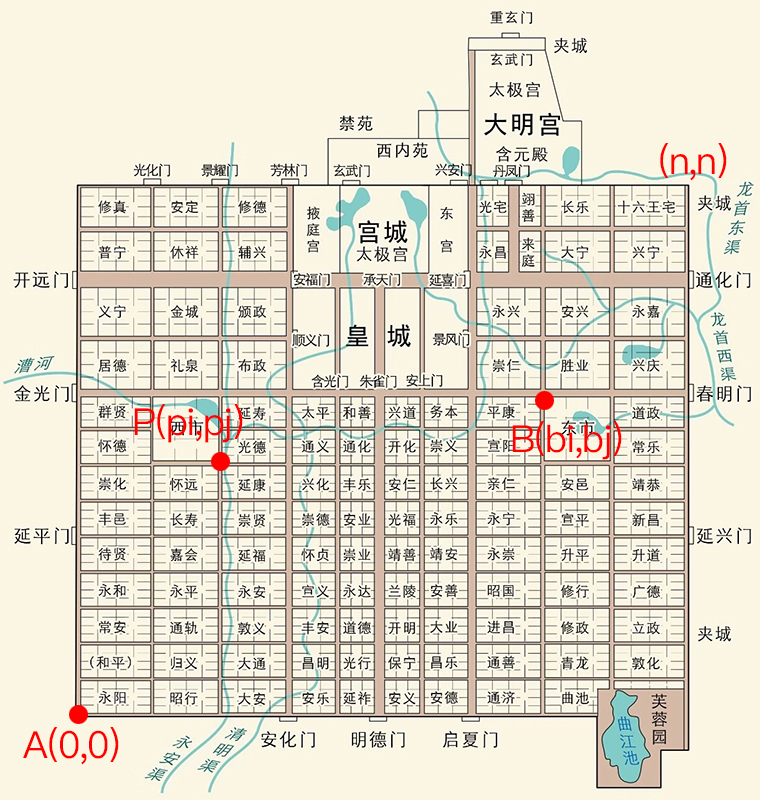

# 070 【专业融合：建筑】长安

Time Limit: 1000ms , Memory Limit: 10000KB

## Description

西安古称长安，唐朝的都城。唐长安城，初名大兴城，始建于隋朝开皇元年，唐朝建立后，易名为长安城，属京兆府长安县、万年县，是当时世界上规模最大的城市。长安城由外郭城、皇城、宫城、禁苑、坊市组成，城中东西、南北交错的二十五条大街，将全城分为二市108坊，面积约87.27平方公里。城内百业兴旺、宫殿参差毗邻，最多时人口近100万，所有坊里全部沿着中轴线整齐对称、均匀分布，具有独特的布局。



唐代盛行骑乘之风，其中最流行的交通工具是骑马。现在，我们穿越回唐朝，如图所示，从A点（假定其坐标为0,0）到B点，需要经过多条坊街。要求每次只能向上或向右移动一坊，并且不能经过P点。

## Input

每行输入B点坐标bx、by和P点坐标px、py，用空格间隔。若任一坐标值$`\leqslant 0`$，程序结束。

## Output

对每行输入，计算从A点到B点且不经过P点的路径有多少种？
样例解释：

1. B点（8,6），P点（5,3），路径有492种；
2. B点（8,6），P点（8,6），由于P点即是B点，故路径0种；
3. B点（8,6），P点（9,6），P点在路线之外，路径有792种。

## Sample Input

```
8 6 5 3
8 6 8 6
8 6 9 6
0 0 0 0
```

## Sample Output

```
492
0
792
```

---
---

## 测试点

### 测试点 1

输入：

```
8 6 5 3
8 6 8 6
8 6 9 6
0 0 0 0
```

输出：

```
492
0
792
```

### 测试点 2

输入：

```
7 5 3 3
0 0 0 0
```

输出：

```
120
```
