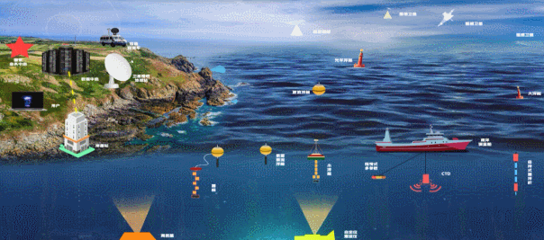
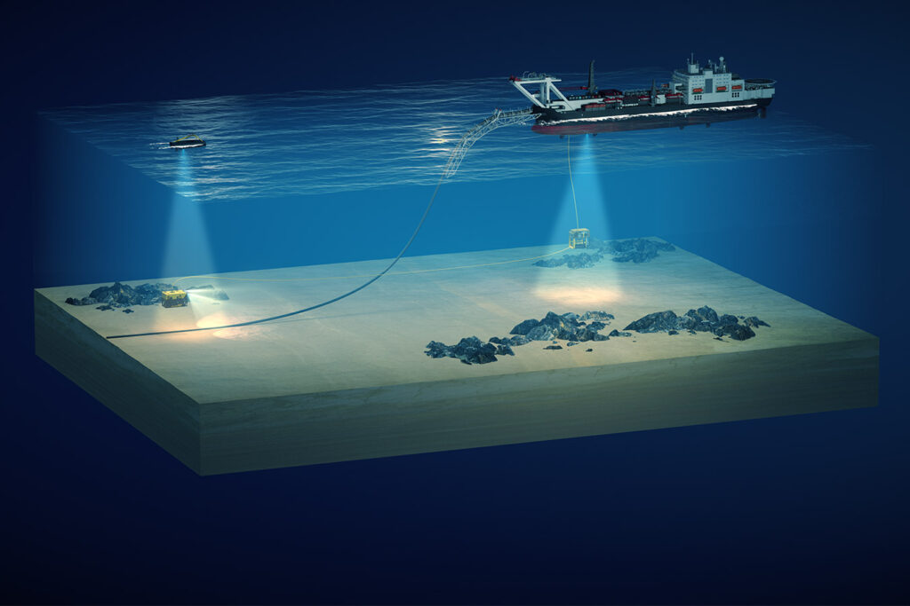
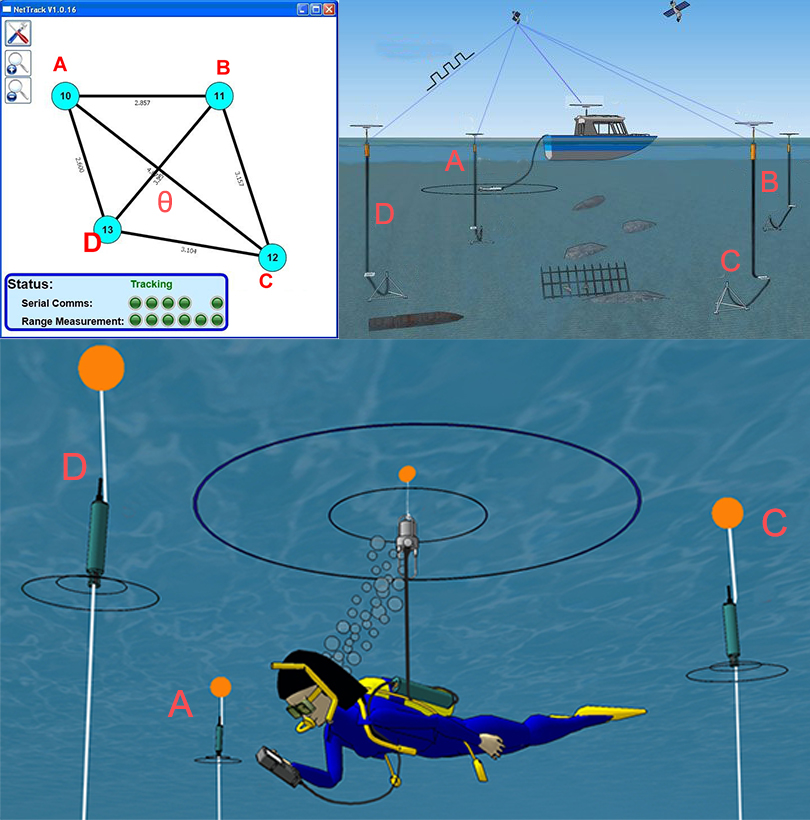

# 071 【专业融合：航海】水下声学定位

> 提交文件名：`T071.cpp` ｜ 时限 1000ms ｜ 内存 10000KB

## 题目描述

当前，世界科技发展呈现新的趋势，向“深空、深海、深地、深蓝”制高点迈进。为了建设海洋强国，我国制定了深海战略，向大海深处，进发！



海洋技术包括海洋探测技术、海洋开发技术、海洋通用技术，目前有五个重点领域：海洋生物技术、海洋生态系统模拟技术、海洋油气资源高效勘探开发技术、海洋环境观测和监测技术、海底勘测和深潜技术等。



水下声学定位系统（Underwater acoustic positioning system）是一种通过声学距离（和/或）方向测量以及随后的位置三角测量来跟踪和导航水下航行器或潜水员的系统，通常用于各种水下工作，包括石油和天然气勘探、海洋科学、打捞作业、海洋考古和军事活动等。水下声学定位系统通常分为三大类：长基线 (LBL) 系统、超短基线 (USBL) 系统 、短基线 (SBL) 系统，精度可以达到几厘米至几十米，工作距离可以从几十米至几十公里。如下图所示。



计算机向一个响应器（例如 A）发送指令进行传输，同时指示其他响应器（例如 B、C、D）进行接收。通过这种方法，可以测量所有六个距离（A-B、A-C、A-D、B-C、B-D、C-D）。四个边和一条对角线用于几何形状和面积进行三角测量，另一条对角线可用于消除误差。现在将问题简化，求ABCD面积和θ角，后续就能够进行定位了。

## 输入

在一行里输入4个边长AB、BC、CD、DA和对角线长，用空格间隔。输入数据保证有意义。

## 输出

一行里输出ABCD面积和θ角，用空格间隔。面积保留6位小数，θ角单位为度，保留1位小数。

## 样例

**输入**

```
7 5 5 7 6
```

**输出**

```
29.393877 90.0
```

## 来源

水下声学定位系统
https://en.wikipedia.org/wiki/Underwater_acoustic_positioning_system
四边形的面积公式
https://zhuanlan.zhihu.com/p/25937122
新南海 科技海 ——自然资源部南海局南海区海洋科技未来发展方向解析
http://scs.mnr.gov.cn/scsb/fjdt/202011/483fec708c544755bc502b987591188f.shtml
Pipeline positioning
https://www.sonardyne.com/applications/pipeline-positioning/

【计算示例】
https://www.toppr.com/ask/question/the-lengths-of-four-sides-and-a-diagonal-of-the-given-quadrilateral-are-indicated-in/
https://www.quora.com/How-can-I-derive-the-area-of-an-irregular-quadrilateral-given-just-4-sides
https://www.cuemath.com/measurement/area-of-quadrilateral/
