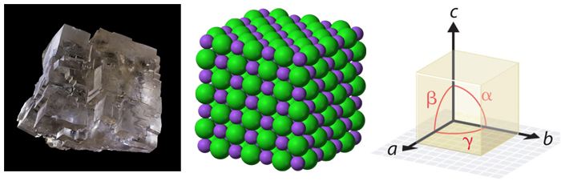
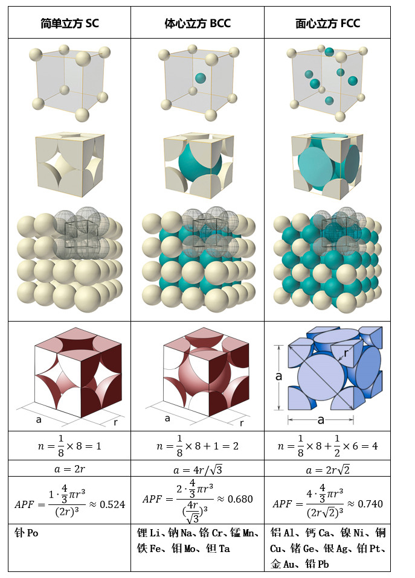
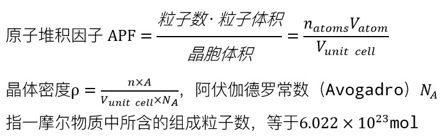
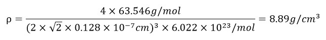

# 073 【专业融合：材料】晶体结构

> 提交文件名：`T073.cpp` ｜ 时限 1000ms ｜ 内存 10000KB

## 题目描述

晶体（Crystal）是原子、离子或分子按照一定的周期性，在结晶过程中，在空间排列形成具有一定规则的几何外形的固体。晶体的分布非常广泛，自然界的固体物质中，绝大多数是晶体，气体、液体和非晶物质在一定的合适条件下也可以转变成晶体。晶体结构（Crystal Structure）是对晶体材料中原子、离子或分子有序排列的描述。有序结构源于组成粒子的内在本质，形成沿物质三维空间主方向重复的对称图案。构成这种重复图案的材料中最小的颗粒称为晶胞（Unit Cell），晶胞完全反映了整个晶体的对称性和结构。晶胞主轴或边的长度以及它们之间的角度是晶格（Lattice）常数，也称为晶格参数或晶胞参数。如图是食盐的晶体结构，紫色为钠，绿色为氯。



晶胞的几何形状为平行六面体，提供六个晶格参数，分别为晶胞边缘的长度（a，b，c）和它们之间的角度（α，β，γ）。晶胞内粒子的位置由沿晶胞边缘的坐标($x_i$, $y_i$, $z_i$)描述，从参考点测量。
典型立方晶系由三种不同类型的晶胞组成：简单立方（SC，Simple cubic）、体心立方（BCC，Body-centered cubic）、面心立方（FCC，Face-centered cubic）。如下图所示。





上图中，r为原子半径，a为晶胞边长，n是一个晶胞中的原子数，原子堆积因子APF是原子占据的一个晶胞体积的比例。晶体的密度计算公式中，A代表原子的摩尔质量，V代表晶胞体积。
下面以铜的晶体密度为例，介绍晶体密度ρ的计算步骤：
（1）确定晶体的晶胞结构，求出晶胞内原子个数。
查表，铜Cu的结构是面心立方FCC，晶胞八个顶角处各有八分之一个铜原子，因此实际上一个铜原子占据了铜晶胞的八个顶角。此外，面心立方晶胞的六个面中每个面含有二分之一个铜原子，因此六个面一共有三个铜原子。综上，一个铜的晶胞内含有四个铜原子，即n=4。
（2）根据元素周期表查找晶体元素的摩尔质量。单击查看下载周期表、打开周期表大图。
铜的化学元素符号为Cu，查表，铜的摩尔质量为63.546克每摩尔，即A=63.546g/mol。
（3）根据几何关系求出晶胞的体积。
根据元素周期表可以查得铜的原子半径r为128pm（0.128nm），根据勾股定理，可以计算出晶胞边长a，再根据立方体的体积公式可以算得铜的晶胞体积V。
（4）代入公式计算求得晶体密度。
将体积转换成立方厘米单位，计算出铜的晶体密度如下：



## 输入

在第一行里输入一个整数T，表示测试用例数。接下来的T行，每行输入元素名称简写（大小写有区分）。输入元素名称在上述表格范围。

## 输出

对每一个元素，输出晶体密度计算结果，小数点保留两位，每行一个。

## 样例

**输入**

```
3
Po
Mo
Cu
```

**输出**

```
9.15
9.63
8.89
```

## 来源

【计算】
材料视界｜晶体密度计算公式详解与应用
https://baijiahao.baidu.com/s?id=1747843433709390947铜 8.91
晶体结构中的基本概念-1
https://zhuanlan.zhihu.com/p/409507869
https://www.toppr.com/guides/chemistry/the-solid-state/density-of-a-cubic-crystal/

https://chem.libretexts.org/Courses/University_of_California_Davis/UCD_Chem_002B/UCD_Chem_2B/Text/Unit_II%3A_States_of_Matter/12%3A_Intermolecular_Forces_(Liquids_and_Solids)/12.6%3A_Crystal_Structures
钋Po 9.16
镍Ni 8.90
钙Ca 1.53

https://socratic.org/questions/how-to-calculate-the-density-of-this-crystal
https://wisc.pb.unizin.org/minimisgenchem/chapter/types-of-unit-cells-body-centered-cubic-and-face-centered-cubic-m11q5/
钙Ca

https://chem.libretexts.org/Courses/University_of_Arkansas_Little_Rock/Chem_1403%3A_General_Chemistry_2/Text/12%3A_Solids/12.01%3A_Crystal_Lattices_and_Unit_Cells
钋Po 9.32
钼Mo 10.28
钙Ca 1.54
Density of a Unit Cell
crystal density calculation
钽Ta 16.6
铝Al 2.697

【元素周期表】
Printable Periodic Table of Elements
https://www.vertex42.com/ExcelTemplates/periodic-table-of-elements.html
https://www.nist.gov/pml/periodic-table-elements

【图公式】
https://en.wikipedia.org/wiki/Atomic_packing_factor
元素晶体结构
Crystal Structure of the elements
https://periodictable.com/Properties/A/CrystalStructure.html

【参考】
https://zh.wikipedia.org/wiki/晶体
https://en.wikipedia.org/wiki/Crystal
https://en.wikipedia.org/wiki/Crystal_structure
https://en.wikipedia.org/wiki/Miller_index

https://msestudent.com/simple-cubic-unit-cell/
https://msestudent.com/face-centered-cubic-fcc-unit-cell/
https://msestudent.com/body-centered-cubic-bcc-unit-cell/
Simple Cubic Crystal Structure
https://www.e-education.psu.edu/matse81/node/2131
Body Centered Cubic Structure (BCC)
https://www.e-education.psu.edu/matse81/node/2132
Face Centered Cubic Structure (FCC)
https://www.e-education.psu.edu/matse81/node/2133
Hexagonal Close Packed Crystal Structure (HCP)
https://www.e-education.psu.edu/matse81/node/2134

Crystal Plane d-spacings and Interplanar Angles
https://warwick.ac.uk/fac/sci/physics/research/condensedmatt/magxray/group/tomhase/test/
https://www.calculatoratoz.com/en/root-formula-PDF/download-1
