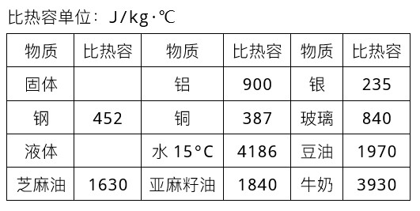

# 074 【专业融合：动能】热能计算

> 提交文件名：`T074.cpp` ｜ 时限 1000ms ｜ 内存 10000KB

## 题目描述

比热容（Specific heat capacity，符号c，https://en.wikipedia.org/wiki/Specific_heat_capacity），简称比热，亦称比热容量，是热力学中常用的一个物理量，表示物体吸热或散热能力，它指单位质量的某种物质升高或下降单位温度所吸收或放出的热量。其国际单位是焦耳每千克开尔文[J/(kg·K)]，即令1公斤物质的温度上升1开尔文所需的能量。有以下公式：

$$
\begin{flalign}
&c=\frac {Q}{m \Delta T}&&\\
\end{flalign}
$$

其中$Q$是能量，单位是焦耳（J）。$m$是质量，单位是千克（kg）。$\Delta T$是温度变化，单位是开尔文（K）。当比热容越大时，该物质便需要更多热能来加热。
下面是常见物质的比热容数据。



如果使用M千克的某种材质的容器，将F千克的某液体从温度Ti加热到Tf，编程计算需要多少热能，用于容器和液体的热能百分比分别是多少。

## 输入

第一行里输入两个数Ti、Tf，用空格间隔，表示初始温度、加热温度。
第二行里输入两个数m、c，用空格间隔，表示液体的质量、比热容。
第三行里输入两个数m、c，用空格间隔，表示容器的质量、比热容。
输入数据保证有意义。
样例数据的生活实际就是：炉子上0.5kg的铝锅中的0.25kg的水从20℃加热到80℃。

## 输出

输出需要多少热能（kJ，千焦耳）、容器热能百分比、液体热能百分比，用逗号间隔，保留小数点两位。

## 样例

**输入**

```
20 80
0.250 4186
0.500 900
```

**输出**

```
89.79kJ,0.30%,0.70%
```

## 来源

Temperature Change and Heat Capacity
https://courses.lumenlearning.com/suny-physics/chapter/14-2-temperature-change-and-heat-capacity/
https://zh.wikipedia.org/wiki/比热容
https://en.wikipedia.org/wiki/Specific_heat_capacity
Calculate Energy in C++
https://codepal.ai/code-generator/query/x2MmpblT/calculate-energy-cpp
Calculate Energy Needed to Heat Water - Java Code
https://codepal.ai/code-generator/query/aKsHqMDy/java-code-calculate-energy-needed-heat-water
https://github.com/jsquared21/Intro-to-Java-Programming/blob/master/Exercise_02/Exercise_02_10/Exercise_02_10.java
Specific Heat Formula
https://www.softschools.com/formulas/physics/specific_heat_formula/61/
https://www.quora.com/How-do-you-calculate-the-energy-required-to-heat-water
