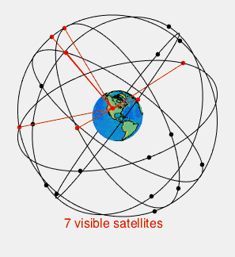

# 075 【专业融合：航天】卫星定位

> 提交文件名：`T075.cpp` ｜ 时限 1000ms ｜ 内存 10000KB

## 题目描述

卫星导航系统（Global Navigation Satellite System, GNSS）是覆盖全球的卫星系统，允许小巧的GNSS电子接收器确定它所在的位置（经度、纬度和高度）及精确的时间。目前，GNSS有中国北斗（30颗卫星）、美国GPS（24颗卫星）、俄罗斯GLONASS（24颗卫星）和欧盟GALILEO（24颗卫星），以及区域导航系统印度IRNSS（7颗卫星）、日本QZSS（5颗卫星）。如下图所示。



卫星定位的原理是地球上任一坐标点(x,y,z)，与三个已知位置的卫星连线交于此点，可联立方程求解。
伪距是由卫星发射的测距码信号到达GNSS接收机的传播时间乘以光速所得出的量测距离。由于卫星时钟、接收机时钟的误差以及无线电信号经过电离层和对流层中的延迟，实际测出的距离与卫星到接收机的几何距离有一定差值。将差值d也作为未知数，则要进行精确定位至少需要4颗卫星才能够求解出(x,y,z,d)。如下式
其中x、y、z是接收器的笛卡尔坐标，A、B、C是卫星的坐标，d是接收器和卫星时钟之间的时间差，t是信号从卫星到接收器的传播时间，c是光速=299792.458。

$$
\begin{align}
f_1=(x-A_1)^2+(y-B_1)^2+(z-C_1)^2-(c(t_1-d))^2=0 \\
f_2=(x-A_2)^2+(y-B_2)^2+(z-C_2)^2-(c(t_2-d))^2=0 \\
f_3=(x-A_3)^2+(y-B_3)^2+(z-C_3)^2-(c(t_3-d))^2=0 \\
f_4=(x-A_4)^2+(y-B_4)^2+(z-C_4)^2-(c(t_4-d))^2=0
\end{align}
$$

下面介绍牛顿法（Newton's method，https://en.wikipedia.org/wiki/Newton's_method）求解上述方程的根。

基于泰勒级数展开，$x_1 = x_0 - {f(x_0) \over f'(x_0)}$ 是比 $x_0$ 更好的根近似值，该过程重复为 $x_{n+1} = x_n - {f(x_n) \over f'(x_n)}$ 。对于多个变量多个函数的非线性方程组求根，可以推广为 $X_{n+1} = X_n - { J_F(X_n)^{-1} F(X_n)}$，从单变量$x$到$X$向量，其中$J_F(X_n)^{-1}$为雅可比矩阵$J_F(X_n)$的逆矩阵，具体为：

$$
J = \begin{bmatrix}
       \partial f \over x_1 & \dots & \partial f \over x_n
     \end{bmatrix}
  = \begin{bmatrix}
       \partial f_1 \over x_1 & ... & \partial f_2 \over x_n \\
       \vdots & \ddots & \vdots \\
       \partial f_n \over x_n & \dots & \partial f_n \over x_n
     \end{bmatrix}
$$

结合本题有

$$
J = \begin{bmatrix}
       2(x-A_1) & 2(y-B_1) & 2(z-C_1) & 2(299792.458)^2(t_1-d) \\
       2(x-A_2) & 2(y-B_2) & 2(z-C_2) & 2(299792.458)^2(t_2-d) \\
       2(x-A_3) & 2(y-B_3) & 2(z-C_3) & 2(299792.458)^2(t_3-d) \\
       2(x-A_4) & 2(y-B_4) & 2(z-C_4) & 2(299792.458)^2(t_4-d)
     \end{bmatrix}
$$

下面给出求根的原理说明、手工计算求根的过程图示、程序代码。下载讲义、范例图示、下载范例代码。
应用范例代码，结合下面循环步骤计算定位结果坐标。
（1）设定20次循环
（2）计算F矩阵
（3）计算J矩阵
（4）求J的逆矩阵
（5）求J的逆矩阵与F矩阵乘积V
（6）求Xn=X0-V
（7）X0=Xn，以便下次迭代
（8）计算F矩阵的每个元素的绝对值的最大值m，如果m小于精度要求1e-6，则循环结束，否则重复（1）~（8）步骤。

## 输入

前4行输入四颗卫星的A、B、C坐标，用空格间隔。
第5行输入t1、t2、t3、t4，用空格间隔。
第6行输入牛顿迭代法初值x0、y0、z0、d0，用空格间隔。
输入数据保证有意义。

## 输出

输出定位坐标，小数点4位以后截断（非四舍五入），用逗号间隔。
迭代条件为20次迭代或者Fn绝对值的最大值小于1e-6。

## 样例

**输入**

```
15600 7540 20140
18760 2750 18610
17610 14630 13480
19170 610 18390
0.07074 0.07220 0.07690 0.07242
0 0 6370 0
```

**输出**

```
-41.7727,-16.7891,6370.0595
```

## 来源

问题
Solving the GPS Equations
https://mason.gmu.edu/~treid5/Math447/GPSEquations/
Solving a multivariate non-linear system of equations using Newton's method
https://math.stackexchange.com/questions/1306112/solving-a-multivariate-non-linear-system-of-equations-using-newtons-method
原理
航天科普 | 5分钟了解GPS定位原理
https://zhuanlan.zhihu.com/p/484849603
北斗/GPS 卫星定位导航算法
https://zhuanlan.zhihu.com/p/370761604

求解非线性方程组根
Numerical Methods for Solving Systems of Nonlinear Equations
用牛顿-雅可比迭代法求非线性方程组的根
Newton's method
https://en.wikipedia.org/wiki/Newton's_method
Calculating Position from Raw GPS Data
https://www.telesens.co/2017/07/17/calculating-position-from-raw-gps-data/
【数据】
"XYZ ECEF" or "NMEA" data
【代码参考】
求解方程组的改进Newton-Raphson方法
Modified Newton Raphson method for solution of systems of equations
(Multivariate Newton Raphson method)
https://atozmath.com/
https://atozmath.com/CONM/NewtonRaphson2.aspx
https://atozmath.com/CONM/NewtonRaphson2.aspx?q1=x%5e2-2x%2by%5e2-z%2b1%3d0%3bxy%5e2-x-3y%2byz%2b2%3d0%3bxz%5e2-3z%2byz%5e2%2bxy%3d0%601%2c2%2c3&dp=4&do=1#PrevPart

Multivariate Newton-Raphson Solver for a Coupled Non-linear equations
https://skill-lync.com/student-projects/Multivariate-Newton-Raphson-Solver-for-a-Coupled-Non-linear-equations-25511
Week 6 - Multivariate Newton Rhapson Solver
https://skill-lync.com/student-projects/week-6-multivariate-newton-rhapson-solver-49
【参考资料】
Jacobian to do Newton's method
https://math.stackexchange.com/questions/2052358/jacobian-to-do-newtons-method
cppopt
Numerical optimization in C++
https://github.com/cheind/cppopt
Multidimensional Root-Finding
https://www.gnu.org/software/gsl/doc/html/multiroots.html
Class 8: Roots and minima, more C++, and using external libraries
https://www.phys.ksu.edu/personal/gahs/phys707-prog/Class8.html
NonlinearSystem
Solving Non-linear Systems
https://mooseframework.inl.gov/source/systems/NonlinearSystem.html
C语言牛顿迭代法求解非线性方程组
https://www.freesion.com/article/6868942695/
牛顿迭代法求解非线性方程组
https://zhuanlan.zhihu.com/p/580580125
非线性方程组——牛顿迭代求根
https://blog.csdn.net/m0_71253709/article/details/129875060
【坐标系转换】
Equations to convert from global cartesian coordinates to geographic coordinates
https://gis.stackexchange.com/questions/120679/equations-to-convert-from-global-cartesian-coordinates-to-geographic-coordinates
How do I calculate a xyz-position of one GPS position relative to another?
https://gis.stackexchange.com/questions/23793/how-do-i-calculate-a-xyz-position-of-one-gps-position-relative-to-another
【求逆矩阵】
Calculation of matrix inverse in C/C++
https://chi3x10.wordpress.com/2008/05/28/calculate-matrix-inversion-in-c/
C++ Program to Find Inverse of a Graph Matrix
https://www.tutorialspoint.com/cplusplus-program-to-find-inverse-of-a-graph-matrix
Inverse of a Matrix in C++
https://www.delftstack.com/howto/cpp/cpp-inverse-matrix/
测试数据
Adjoint and Inverse of a Matrix
https://www.geeksforgeeks.org/adjoint-inverse-matrix/
https://stackoverflow.com/questions/60300482/c-calculating-the-inverse-of-a-matrix
