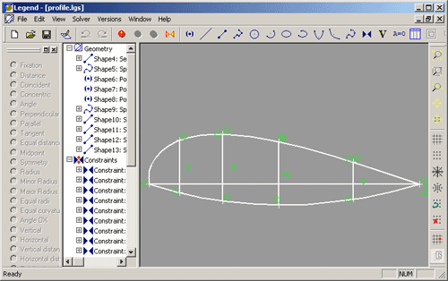

# 077 【专业融合：机械】几何约束

Time Limit: 1000ms , Memory Limit: 10000KB

## Description

今天，中国的工程师们正在加快解决软件“卡脖子”，其中工业软件就是“工业大脑”。
机械工程是现代工程领域中最重要的分支之一，涵盖了机器设计、制造、自动化、材料科学等多个方面，而CAD（计算机辅助设计）、CAM（计算机辅助制造）和CAE（计算机辅助工程）是其三大核心技术。
CAD（Computer-aided design，计算机辅助设计）使用计算机（或工作站）帮助创建、修改、分析或优化设计，它有两大底层核心技术：三维几何建模引擎和几何约束求解器。
CAD自20世纪60年代以来已发展了60年，取得了辉煌成就，被评为20世纪十大工程技术创新。经过几十年市场竞争演化，CAD技术与产品已形成垄断。美国AutoDesk公司、德国西门子公司和法国航空巨头达索公司开展了大规模并购，打造全生命周期工业软件体系，进一步巩固强化其技术和市场优势。
CAD中的约束是指设计者或工程师对设计模型实体的几何属性施加的限制或约束，使该实体在操作模型时保持其结构，这些属性可包括相对长度、角度、方向、尺寸、位移和位移。例如多边形上的布尔运算（AND、OR、NOT、XOR...），就是一种约束求解，这些操作广泛应用于计算机图形学、CAD和EDA（集成电路物理设计和验证软件）中。



编写程序解决CAD几何约束中的一个问题，平面上有n（n≤20）个线段，判断是否有任意两个线段相交，输出相交的线段号，最后输出相交的总数。

## Input

在第一行里输入正整数n，接下来的n行，每行都输入x1、y1、x2、y2，用空格间隔，表示一个线段的左右两点坐标。输入数据保证有意义。

## Output

如果存在两个线段相交，输出一行结果：先是输出“X: ”，然后输出两个交叉线段的索引号，前缀“#”，用空格间隔。
最后一行输出“n=”和线段相交的总数。如果没有线段相交，则前述不输出，只输出“n=0”表示无线段相交。
相交线段的输出，按线段输入顺序编号，相交线段按编号由小到大顺序输出。如果两个线段相交，第一个编号总是小于第二个编号，例如“#1 #2”正确，“#2 #1”虽然同样是1、2线段，但是不满足要求的记录。

## Sample Input

```
5
1 5 4 5
2 5 10 1
3 2 10 3
6 4 9 4
7 1 8 1
```

## Sample Output

```
X: #1 #2
X: #2 #3
n=2
```

---
---

## 测试点

待探测。
