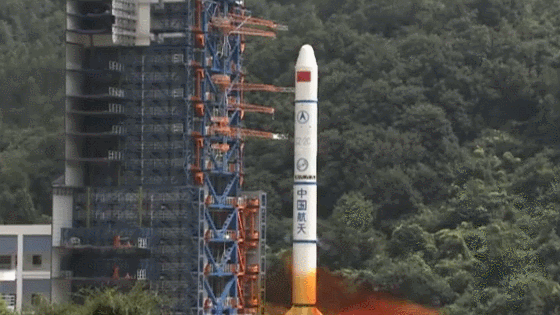

# 078 【专业融合：力学】火箭发射模拟

Time Limit: 1000ms , Memory Limit: 10000KB

## Description

编写程序模拟从地球表面垂直火箭发射。



依据牛顿第二定律$F=ma$，$F$是施加在物体上的净力（所有力的总和），$m$是该物体的质量，$a$是该物体产生的加速度。假设火箭从某个天体上起飞（例如地球）。无论在行星上的哪个位置，重力都会将火箭拉回，因此相对于发射它为负项。
火箭在发射时会产生推力，该力取决于两个量：火箭推进剂的质量流量（火箭每秒使用多少推进剂）和火箭的有效排气速度（推进剂的排出速度）。假设质量流量$\dot{m}$是常数，则可以通过推进剂的质量除以燃烧时间简单算出。有效排气速度cE由一系列因素决定，例如推进剂类型、最高燃烧温度和喷嘴形状等，这里作为给定值提供，由此得出寻找加速度所需要的临界方程：$T=\dot{m} \times cE$。
假设作用在火箭上的力只有推力和重力（实际上还有很多，尤其是大气阻力），可以使用方程$T-mg=ma$来求解加速度a，其中mg是重力，地球上$g$为9.81，月球为1.62，火星为3.711，木星为24.79。
质量流量和有效排气速度为恒定值，则推力是恒定的。随着海拔的增加，重力会略有减小，这里假设它也是一个常数。但是，火箭质量会随着时间的推移而变化，这意味着必须使用上述方程不断重新计算推力值。
具体方法是：
（1）推进剂质量等于火箭初始质量减去火箭自身干质量
（2）质量流量$\dot{m}$等于推进剂质量除以燃烧时间
（3）计算$T=\dot{m} \times cE$
（4）计算加速度$a=T/m-g$，然后假设它在较短的时间间隔（称为时间步长timestep，取0.1）内近似恒定
（5）通过这个加速度，可以算出近似速度增量$\Delta Velocity = a \times timestep$
（6）进而计算出海拔高度增量$\Delta Altitude = Velocity \times timestep$
（7）然后推进剂质量减去该时间步长中消耗的燃料量$\dot{m} \times timestep$
（8）时间向前一步，重复（4）~（8）过程，直到燃烧时间结束。

## Input

火箭初始质量包括有效载荷（例如所发射的卫星）、推进剂和火箭自身。
在一行里输入火箭初始质量、火箭自身干质量、燃烧时间、有效排气速度、重力g，用空格间隔。输入数据保证有意义，这里g还可以是地球以为的其他天体的值。

## Output

输出在整个燃烧时间内，火箭发射到的海拔高度，单位为km，保留三位小数。

## Sample Input

```
100000 10000 100 4000 9.81
```

## Sample Output

```
298.766km
```
