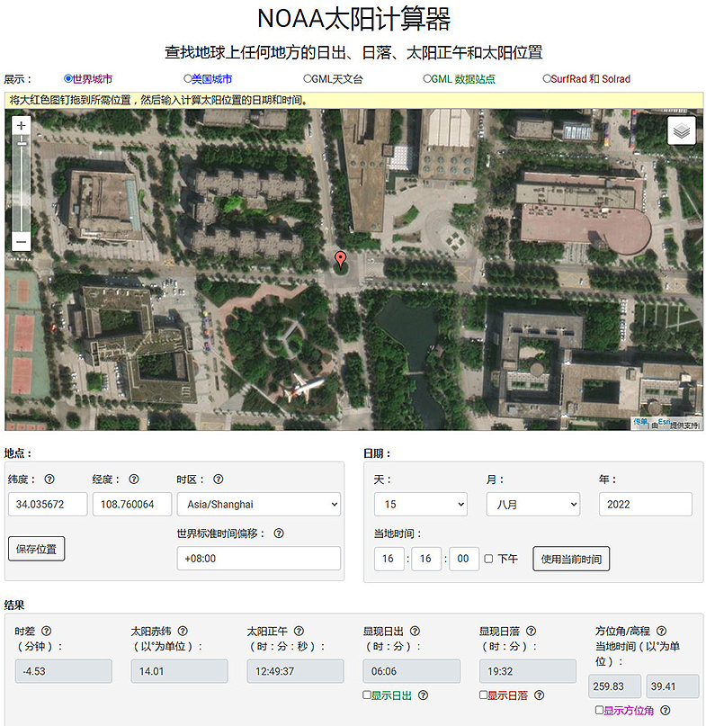

# 080 【专业融合：天文】日出日落时间

> 提交文件名：`T080.cpp` ｜ 时限 1000ms ｜ 内存 10000KB

## 题目描述

在（https://gml.noaa.gov/grad/solcalc/）网站上有一个实用程序，NOAA太阳计算器（NOAA Solar Calculator），可以查找地球上任何地方的日出、日落、太阳正午和太阳位置，如下图所示。



编写程序，输入某天（年月日）、某地（经纬度）和时区，输出当地的太阳正午、日出、日落时间。
请下载NOAA日出日落算法，据此编写程序代码实现。

## 输入

在第一行里输入3个整数y、m、d，用空格间隔，表示某一天的日期（年、月、日）。在第二行里输入2个双精度数lon、lat，用空格间隔，表示某地的经度、纬度（纬度 南半球为负、北半球为正, 经度西半球为负、东半球为正）。在第三行里输入1个双精度数，表示时区（西半球为负、东半球为正，在-12至12之间）。输入数据保证有意义。
样例数据的实际含义是：2022年8月15日，西北工业大学长安校区银河路转盘（东经108.760064，北纬34.035672），东8区。
如果选择同一时间的上海市东方明珠塔（东经121.498146，北纬31.243333），则结果为Solar Noon=11:58:40，Sunrise=05:19:21，Sunset=18:37:20。
如果选择同一时间的中国最西边帕米尔高原（东经73.6138916，北纬39.264157），则结果为Solar Noon=15:10:11，Sunrise=08:18:09，Sunset=22:01:23。
如果选择2022年12月22日（冬至），黑龙江省漠河市中国最北点（东经123.277587，北纬53.555198），则结果为Solar Noon=11:45:02，Sunrise=08:01:32，Sunset=15:29:02。
如果选择2022年12月22日（冬至），南海曾母暗沙（东经112.241821，北纬3.5380934），则结果为Solar Noon=12:29:12，Sunrise=06:31:50，Sunset=18:27:04。
我爱你，中国！

## 输出

输出某地某一天的太阳正午、日出、日落的时间（采用HH:MM:SS形式），每行一个。并且在时间之前分别加上“Solar Noon=”，“   Sunrise=”，“    Sunset=”，输出效果以“=”右对齐，参见样例。

## 样例

**输入**

```
2022 8 15
108.760064 34.035672
8.0
```

**输出**

```
Solar Noon=12:49:37
   Sunrise=06:06:10
    Sunset=19:32:22
```

## 来源

【计算器】
NOAA Solar Calculator
https://gml.noaa.gov/grad/solcalc/
https://gml.noaa.gov/grad/solcalc/calcdetails.html
https://gml.noaa.gov/grad/solcalc/solareqns.PDF
Solar Position Calculator
https://gml.noaa.gov/grad/solcalc/azel.html
NOAA Improved Sunrise Sunset Calculation
Sunrise/Sunset Calculator
https://gml.noaa.gov/grad/solcalc/sunrise.html
https://www.ladybug.tools/ladybug-web/solar-calculator-noaa/ladybug-web-solar-calculator-noaa-viewer-r3.html

Celestial Programming : Rise and Set Algorithm
https://www.celestialprogramming.com/risesetalgorithm.html

【算法】
Sunrise/Sunset Algorithm
https://edwilliams.org/sunrise_sunset_algorithm.htm
https://gist.github.com/mrgame64/c82248df7c72d623eb80
Sunrise equation
https://en.wikipedia.org/wiki/Sunrise_equation
math tool to compute time of sunrise and sunset
https://astronomy.stackexchange.com/questions/51658/math-tool-to-compute-time-of-sunrise-and-sunset

Astronomical Calculations: The Julian Day
https://squarewidget.com/julian-day/

【源码】
Sunrise/Sunset Calculations
https://www.codeproject.com/Articles/645/Sunrise-Sunset-Calculations

Calculate Sunrise and Sunset based on time and latitude and longitude
Calculate Sunrise and Sunset and the phase of the moon accurately based on date and geographic position
https://github.com/buelowp/sunset

sunrise.c
https://souptonuts.sourceforge.net/code/sunrise.c.html
https://sourceforge.net/projects/souptonuts/

sunrise sunset times in c
https://stackoverflow.com/questions/7064531/sunrise-sunset-times-in-c

Calculate Sunset and Sunrise Times in JavaScript
https://codepal.ai/code-generator/query/19HRYmLj/javascript-calculate-sunrise-sunset-times

【参考】
https://zh.wikipedia.org/zh-cn/公历
https://en.wikipedia.org/wiki/Gregorian_calendar
https://en.wikipedia.org/wiki/Julian_calendar
https://zh.wikipedia.org/wiki/儒略历
Position of the Sun
https://en.wikipedia.org/wiki/Position_of_the_Sun
Sunrise equation
https://en.wikipedia.org/wiki/Sunrise_equation

interactive web application
https://andrewmarsh.com/software/
https://andrewmarsh.com/articles/2019/solar-position/
https://drajmarsh.bitbucket.io/earthsun.html
https://drajmarsh.bitbucket.io/sunpath3d.html
https://drajmarsh.bitbucket.io/sunpath2d.html
https://drajmarsh.bitbucket.io/sunpath-on-map.html

日出日落方位的计算 太阳日出日落方位怎么计算
计算器
NOAA Solar Calculator
https://gml.noaa.gov/grad/solcalc/
Sunrise/Sunset Calculator
https://gml.noaa.gov/grad/solcalc/sunrise.html
General Solar Position Calculations
https://gml.noaa.gov/grad/solcalc/solareqns.PDF
NOAA Sunrise/Sunset Calculator
https://web.vscht.cz/~kolafaj/calc/sunrise.html
Sunrise Sunset Calculator
https://www.omnicalculator.com/physics/sunrise-sunset
【参考代码】
C++ Sunrise/Sunset Function
https://codepal.ai/code-generator/query/GDQrUujP/c-function-sunrise-sunset-time
Calculation of sunrise, sunset, twilight times and daylengths for a given latitude, longitude, date and time zone
https://github.com/jarmol/suncalcs
Sunrise/Sunset Calculations
https://www.codeproject.com/Articles/645/Sunrise-Sunset-Calculations
