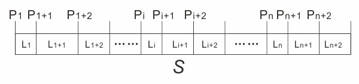

# 081 【算法策略：回溯】和字符串

Time Limit: 1000ms , Memory Limit: 10000KB

## Description

给定一个数字字符串，确定它是否为“和字符串”。所谓和字符串规定如下：
（1）sub_string(P, L)表示从$`S`$串的下标P处开始，取长度L的子字符串
（2）$`P_{1}、P_{1+1}、P_{1+2} \cdots P_{i}、P_{i+1}、P_{i+2} \cdots P_{n}、P_{n+1}、P_{n+2}`$为$`S`$串的若干个下标
（3）$`L_{1}、L_{1+1}、L_{1+2} \cdots L_{i}、L_{i+1}、L_{i+2} \cdots L_{n}、L_{n+1}、L_{n+2}`$为$`S`$串的若干个段长度
（4）上述的下标和长度，是连续的，将$`S`$串分为了$`n`$个部分
（5）有substring($`P_{1}, L_{1}`$)+substring($`P_{1+1}, L_{1+1}`$)=substring($`P_{1+2}, L_{1+2}`$)，substring($`P_{i}, L_{i}`$)+substring($`P_{i+1}, L_{i+1}`$)=substring($`P_{i+2}, L_{i+2}`$)，$`\cdots`$，依次类推。
如下图所示。



## Input

在一行里输入字符串S。

## Output

如果S是“和字符串”输出true，否则输出false。

## Sample Input

```
1212243660
```

## Sample Output

```
true
```

---
---

## 测试点
