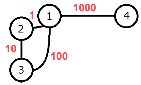

# 086 【算法策略：回溯】游乐园

Time Limit: 1000ms , Memory Limit: 10000KB

## Description

一家新开的游乐园吸引了大家的兴趣，纷纷做起了旅游的“功课”。
该游乐园里面有$N$个景点，标记为$1$到$N$，有$M$条路，标记为$1$到$M$。第$i$条路连接景点$A_i$和$B_i$，双向且长度为$C_i$。
从选择的景点出发，要求不经过重复景点的情况下到达另一个景点，求出走过道路的最大总长度。注意：

$$
\begin{aligned}
&2\leqslant N \leqslant 10\\
&1\leqslant M \leqslant {N(N-1) \over 2}\\
&1\leqslant A_i < B_i \leqslant N\\
&1\leqslant C_i \leqslant 10^8
\end{aligned}
$$

## Input

所有数据都是整数，输入格式如下，用空格间隔：

$$
\begin{matrix}
N & M\\
A_1 & B_1 & C_1 \\
\vdots & \vdots & \vdots \\
A_M & B_M & C_M
\end{matrix}
$$

## Output

输出结果。样例图示如下：



如果从4开始，按4→1→3→2的路线，此时走路的长度1110最大。

## Sample Input

```
4 4
1 2 1
2 3 10
1 3 100
1 4 1000
```

## Sample Output

```
1110
```
