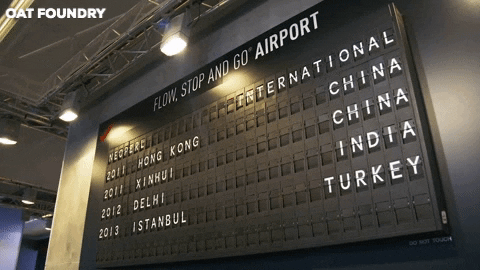
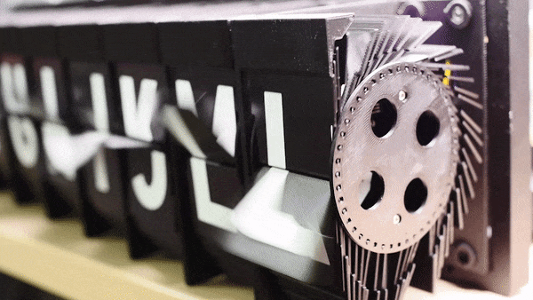

# 091 【考试题型：枚举】机场翻牌显示

Time Limit: 1000ms , Memory Limit: 10000KB

## Description

在机场及一些公共场所，经常采用翻牌机显示器，如下图所示。



它是如何设计生产出来的呢？首先，它有一个电子控制的翻牌机械装置，原理大致如图。



假定翻牌机只处理字母，所有的字母都是一张牌，按顺序叠好。如果想要显示某个字母，那么电控发出信号使装置翻牌n次后显示它，例如当前牌停在“B”上，要显示“D”就要翻牌2次，要显示“B”翻0次（即不翻），而要显示“A”就要先翻到“Z”（24次）再翻到“A”（1次），共25次。
现在设计一个翻牌机显示屏，能够显示“两位字母+四位数字”的国内航班号，已知前一个航班号和下一个航班号，求需要多少次翻牌？
注意字母顺序为“A→Z”循环，数字顺序为“0→1”循环。

## Input

在第一行里输入前一个航班号，在第二行里输入后一个航班号。
输入数据来源于实际生活，样例中的航班号MU2103（东方航空，西安→北京09:00起飞）、CA8326（中国国航，西安→上海12:30起飞）。

## Output

输出总计翻牌次数。

## Sample Input

```
MU2103
CA8326
```

## Sample Output

```
35
```

---
---

## 测试点

待探测。
